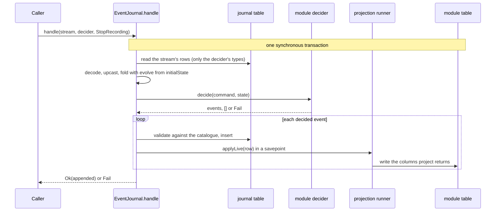

# @vyredo/event-journal

An event-sourced journal on SQLite. A module declares its events (schema,
version, `evolve`, `decide`, `project`) in one object per event; the journal
stores them per stream, upcasts old versions on read, runs commands through a
decider in one transaction, and keeps each module's table in step with its
log.

It knows no application.

```bash
npm install @vyredo/event-journal @vyredo/typed-result drizzle-orm zod
```

Import by path: `@vyredo/event-journal/shared/<file>` for the pure tier (codec,
decider, event definitions; no Node APIs) and `@vyredo/event-journal/node/<file>`
for the store (`node/event_journal`, `node/projection`, `node/table`). The
journal's two tables are `node/table.ts` for drizzle-kit, or
`@vyredo/event-journal/node/schema.sql` to apply as is. Node 22.5+.

## The concept

Six words carry the whole design. They are Emmett's vocabulary, without the
Emmett library.

| Word | What it is | Where it lives |
| ---- | ---------- | -------------- |
| **stream** | One log, named `(streamType, streamId)`. A module declares its kind once, `defineStream("recording")`, and addresses one log with `of(id)`. Everything that folds together is on one stream. | the module's `shared/stream.ts` |
| **event** | One fact on a stream, at one version. Immutable once stored. | one file per event, `<Name>.ejournal.ts` (no version in the name) |
| **state** | What a stream's events add up to. `initialState` is a stream with no events. | the module's events index (Recording: `repository/write/index.ts`) |
| **evolve** | How one event moves the state. Pure; the one place the event's rule is written. | inside the event's file |
| **decide** | What a command produces, given the state. Returns events, `[]` for a retry or a moot command, or a `Fail` for a refusal. Never reads a table. | inside the event's file, under `commands` |
| **project** | Which columns of the module's table the event writes, read off the state `evolve` just produced. A mapping, never a condition. | inside the event's file |

### One event, one file

Everything about an event sits in one file, so a reader never has to open a
second one to learn what it does. The event is a class extending
`EJournalEvent`; its `extends` clause states the contract as a `Shape`, and the
constructor is type-checked against it:

```ts
// an application's RecordingEnded event (abridged)
const payload = z.object({ reason: z.enum(["stop", "watchdog", "interrupted"]) });
const recoverRecording = z.object({ at: z.string().min(1), via: z.string() });

class RecordingEndedEvent extends EJournal.EJournalEvent<RecordingModule, {
  type: "recording.ended";
  v: 1;
  streamType: typeof RecordingStream.type;
  payload: typeof payload;
  commands: { RecoverRecording: z.infer<typeof recoverRecording> };
}> {
  constructor() {
    super({
      type: "recording.ended",
      v: 1,
      streamType: RecordingStream.type,
      schema: payload,

      evolve: (state, { at, payload: p }) =>
        isOpen(state.recording) ? { ...state, recording: { ...state.recording, endedAt: at } } : state,

      commands: {
        RecoverRecording: {
          schema: recoverRecording,
          decide: ({ at, via }, state) =>
            isOpen(state.recording)
              ? Ok([RecordingEnded.make({ reason: "interrupted" }, { at, origin: "app", via })])
              : EventConfig.noEvents(),
        },
      },

      project: ({ recording: s }) => s && { endedAt: s.endedAt },
    });
  }
}

export const RecordingEnded = new RecordingEndedEvent();
```

The rules the class enforces:

- **Every event has at least one command**, and every command is exactly
  `{ schema, decide }`. A `Shape` with no command does not compile. When one
  command decides several events it lives on the first of them:
  `StopRecording` is on `RecordingStopped` and also produces `recording.ended`.
- **`evolve` and `project` are optional.** `RecordingStopped` has neither: it
  moves no state and writes no column.
- **`decide` is checked strictly.** `CommandRule.decide` is a property, not a
  method, so its parameters are not bivariant.

`EJournalEvent` adds no behaviour of its own: it hands the spec to
`defineEvent`, which Recording's raw recording events and Score's events call directly.

### One module, one index

The module's events index (Recording's `repository/write/index.ts`) states the
module with `defineEventModule`: its name
and `version`, its table, the table's shape, its `initialState`, and the list
of its current events. Everything else derives from that list: the event
union, the command union, the decider, the catalogue registration.

```ts
export const recording = EventConfig.defineEventModule({
  name: "recording",
  version: 2,               // bump when an evolve or a project changes
  table: recordingTable,
  projection: { shape: "row", key: "recordingId" },
  initialState: () => ({ recording: null, consentWithheldAt: null, expired: false }),
  events: [RecordingCreated, RecordingStarted, RecordingStopped, RecordingEnded /* ... */],
});
```

The table has one of three shapes, and the shape decides how the runner writes
it:

| Shape | The table holds | Live append | Example |
| ----- | --------------- | ----------- | ------- |
| `row` | one row per stream, keyed by the stream id | re-folds the stream, merges each event's columns, updates the row (inserts only a whole row) | Recording |
| `keyed` | rows keyed within a stream (`scope` + `key`) | re-folds the stream and writes only the keys its events name; `null` deletes one | Recording's raw recordings |
| `append` | rows that follow from one event alone | writes just that event's rows, each replacing the row its `supersede` columns name; no re-fold | Score |

A column no event writes is never touched, so a row written before the
journal existed, or a flag another module owns, survives every rebuild.

### The journal is an instance

`createJournal({ db, log, clock, ids })` returns an `EventJournal`. It owns its
catalogue (which event types it accepts), its projection runner (which tables
it keeps), and nothing global. The application makes exactly one, on the core
database; a test makes its own, so nothing a test registers leaks.

```ts
journal.catalogue.register(module.registration);       // the event types
journal.projections.registerEventModule(module);        // the table
journal.handle(stream, module.decider, command);        // a command
journal.append(event);                                  // a fact another module states
journal.rebuildStream(stream);                          // re-fold from the log
await journal.rebuildStaleStreams();                    // the boot sweep
```

### What happens on a command



Two properties follow from the transaction. Nothing can append to the stream
between the read and the append, so the state a decision was made on is the
state it lands on. And the decided events are all-or-nothing: one refused
append refuses the command and stores none of them.

The fact outlives its fold. If a live projection throws, only its savepoint
rolls back: the event is kept, the domain is marked stale on that stream, and
the boot sweep rebuilds it. A malformed payload is not a fact, so it is
refused and nothing is stored.

### Versioning one event

A stored event is never rewritten. To change a payload, version that one
event, in its own file: the old version becomes a frozen
`retiredEvent({ type, v, schema, upcast })` constant in the same
`<Name>.ejournal.ts`, and the class moves to `v: n+1` and names it in
`previous`. The file name has no version in it, so no import changes. The upcast ladder registers itself, an upcast that does not produce the
next payload is a compile error, and every other event of the module stays
where it is. The application's schema lock (`src/main/event_schemas.lock.json`)
fails if a released `type@v` changes shape.

### Finding who writes an event

A caller builds a command through the event that defines it,
`RecordingStopped.command("StopRecording", { ... })`, never as a bare
`{ type: "StopRecording" }`. So "find references" on `RecordingStopped` lists
every place that can stop a recording.

## Two tiers, two entry points

| Import                       | Tier | What it holds |
| ---------------------------- | ---- | ------------- |
| `@event-journal/shared/*`    | pure | Declaring events and modules (`event/event_config.ts`), the envelope and streams (`event/envelope.ts`), the catalogue, the codec, `fold`/`foldAll`/`Decider`, `reconcile`, JSONL, redaction. No clock, no ids, no storage: browser and worker safe. |
| `@event-journal/node/*`      | node | `createJournal` and `EventJournal` (`node/event_journal.ts`), the store, the projection runner, and the two tables (`node/table.ts`). |

`shared/` never imports `node/`. The pure tier is also compiled for a worker
(`tsconfig.core.json`) and kept deterministic (`check-determinism`).

`db` is any synchronous drizzle SQLite handle (better-sqlite3) whose
migrations include `node/table.ts`'s `journal` and `journal_meta`. `log`,
`clock` and `ids` are optional: the console, the wall clock and
`crypto.randomUUID` by default.

## Used by

HeroVideo (the HeroCam cabinet app) is the first consumer: one journal on its
core database, each module registering its event types and tables at boot.

The event vocabulary, the versioning rules and what belongs in a log are in
`shared/event/README.md`.

## Tests

`npm test` runs on an in-memory `node:sqlite` database (`src/node/test_db.ts`,
test support only) holding `schema.sql`.
